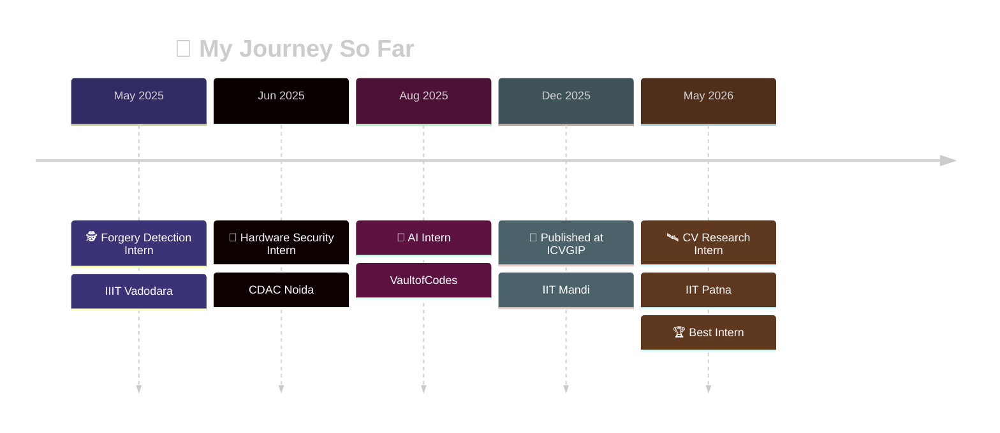

<!-- ═══════════ HEADER ═══════════ -->


<div align="center">

<a href="https://git.io/typing-svg">
  
</a>

<br/>


<br/><br/>

<a href="https://www.linkedin.com/in/rishikesh-gopal/"></a>
<a href="mailto:rishikeshgopal2005@gmail.com"></a>
<a href="https://leetcode.com/"></a>
<a href="https://www.codechef.com/"></a>

</div>

<br/>

---

## 🧑‍💻 About Me

```python
class Rishikesh:
    def __init__(self):
        self.role      = "CSE Undergrad @ IIIT Vadodara (2023–2027)"
        self.focus     = ["Computer Vision", "Deep Learning", "LLM Applications", "Full-Stack"]
        self.research  = "Image Forensics • Remote Sensing (InSAR) • Medical Imaging"
        self.published = "ICVGIP 2025 Workshop, IIT Mandi"
        self.award     = "Best Intern – IMPACT Lab, IIT Patna 🏆"
        self.location  = "Patna, Bihar 🇮🇳"

    def currently(self):
        return "Turning research ideas into deployable AI products"

    def lets_talk_about(self):
        return ["AI/ML", "Computer Vision", "Startups", "Digital Innovation"]
```

<div align="center">

| 🔭 Research | 🌐 Full Stack | 🧠 Problem Solving | 🎓 Recognition |
|:---:|:---:|:---:|:---:|
| 3 internships in CV/AI research | Real-time apps · 500+ users | 400+ problems solved | NTSE State Rank 25 |

</div>

---

## 🛠️ Tech Stack

<div align="center">

**🤖 AI / ML**<br/>
<br/><br/>

**🌐 Web & Backend**<br/>
<br/><br/>

**⚙️ Languages & Core**<br/>
<br/><br/>

**🧰 Tools**<br/>


</div>

<details>
<summary><b>📚 Core CS & Domains (click to expand)</b></summary>
<br/>

`Data Structures & Algorithms` · `OOP` · `Operating Systems` · `DBMS` · `Computer Networks` · `Machine Learning` · `Image Processing` · `Remote Sensing` · `Transfer Learning` · `Siamese Networks` · `WebSockets` · `REST APIs` · `CI/CD` · `RBAC`

</details>

---

## 🏢 Experience

<div align="center">



</div>

<br/>

<!-- ───────── IIT PATNA ───────── -->
<div align="center">


### 🛰️ Computer Vision Research Intern


</div>

> 🧠 **Modified SegFormer-B2** — multi-channel InSAR features, feature-pyramid fusion & hybrid loss for **landslide detection**
>
> 🔁 **Agentic Adaptive Training Framework** — temporal analysis across multi-date acquisitions
>
> 🌐 **AI-Landslide-Assessment-System** — LLM-powered app that turns model output into explainable geological reports

<br/>

<div align="center"></div>

<!-- ───────── ICVGIP ───────── -->
<div align="center">


### 📄 Published Researcher


</div>

> 📖 *"Benchmarking Deep Learning Approaches for Splicing Forgery Detection in Document Image Preprocessing Pipelines"*

<br/>

<div align="center"></div>

<!-- ───────── CDAC ───────── -->
<div align="center">


### 🔐 Hardware Security Intern


</div>

> 🛡️ Analysed **encrypted Verilog HDL circuits** to detect hidden malicious logic

<br/>

<div align="center"></div>

<!-- ───────── IIITV ───────── -->
<div align="center">


### 🕵️ Image Forgery Detection Research Intern


</div>

> 🔬 Benchmarked three CNN architectures via **transfer learning** — the work that became the ICVGIP paper

<br/>

<div align="center"></div>

<!-- ───────── VAULT ───────── -->
<div align="center">


### 🤖 AI Intern


</div>

> 💬 Built an AI assistant for Q&A, summarization & content generation

---

## 🚀 Featured Projects

<div align="center">
<table>
<tr>
<td width="50%" valign="top">

### 📈 Holotrade
*Real-time stock trading simulator*

Built for the IIITV-ICD finance event — **250+ participants, 500+ users, 1,200+ trades**. Live prices, portfolio tracking, P/L, leaderboards, RBAC.

`Node.js` `Express` `MongoDB` `WebSockets` `Chart.js` `D3.js`

[](https://github.com/rishi12145/Paper_Trading_event-IIITV-ICD)

</td>
<td width="50%" valign="top">

### 🧳 TripNshow
*Trip & event booking platform*

**2,500+ simulated bookings**, 1,800+ e-tickets. Integrates Google Maps, OpenWeather, Razorpay & Email APIs. Built in a 5-member team.

`Node.js` `Express` `MongoDB` `REST APIs` `Razorpay`

[](https://github.com/rishi12145/TripNshow)

</td>
</tr>
<tr>
<td width="50%" valign="top">

### 🧠 DDR5 Memory Controller Simulator
*Hardware meets web*

Verilog-based DDR5 controller with read/write/refresh & command scheduling. **50+ scenarios, 20+ parameters**, live visualization.

`Verilog` `Node.js` `JavaScript` `Chart.js`

[](https://github.com/rishi12145/DDR5-Memory-Controller-Simulation-Website)

</td>
<td width="50%" valign="top">

### 🩺 Medical Image Anomaly Detection
*Unsupervised GI endoscopy anomaly detection*

ResNet50 encoder-decoder with MSE + SSIM loss. **94.6% accuracy · 0.9888 ROC-AUC** on HyperKvasir, with heatmap localization.

`PyTorch/TensorFlow` `Deep Learning` `Computer Vision`

</td>
</tr>
<tr>
<td width="50%" valign="top">

### ✍️ Signature Forgery Detection
*Siamese network + handcrafted features*

EfficientNet-B0 + HOG/LBP/PCA with Triplet Loss on **3,460 samples / 173 writers**. 81.5% accuracy · 0.908 AUC. Manuscript in preparation.

`Siamese Net` `Triplet Loss` `Metric Learning`

</td>
<td width="50%" valign="top">

### ⌨️ Typing Speed Test & Game
*C++ OOP desktop app*

Two-mode raylib app with inheritance & polymorphism, real-time WPM/accuracy, difficulty scaling and sound.

`C++` `raylib` `OOP`

[](https://github.com/rishi12145/Typing-Test--Analyser)

</td>
</tr>
</table>
</div>

---

## 📊 GitHub Analytics

<div align="center">


<br/>


<br/><br/>


</div>

---

## 🏆 Achievements

<div align="center">

| 🎖️ | Achievement |
|:---:|:---|
| 🏅 | **Best Intern Award** — IMPACT Lab, IIT Patna |
| 📄 | **Published at ICVGIP 2025** (IIT Mandi) — 99.42% forgery detection accuracy |
| 🎓 | **NTSE Scholar** — State Rank 25 among 10,000+ participants |
| ⚔️ | **LeetCode Knight** (1600+) · CodeChef (1450+) · GFG 1683 (Top 29%) · 400+ problems |
| 💼 | **Secretary, StockOps** — Finance Club, IIIT Vadodara |

</div>

<div align="center">


</div>

---

## 🐍 Contribution Snake

<div align="center">

<picture>
  <source media="(prefers-color-scheme: dark)" srcset="https://raw.githubusercontent.com/rishi12145/rishi12145/output/github-contribution-grid-snake-dark.svg" />
  <source media="(prefers-color-scheme: light)" srcset="https://raw.githubusercontent.com/rishi12145/rishi12145/output/github-contribution-grid-snake.svg" />
  
</picture>

</div>

---

## 🤝 Let's Connect

<div align="center">

I'm always up for conversations about **AI research, computer vision, and building cool products**.

<a href="https://www.linkedin.com/in/rishikesh-gopal/"></a>
<a href="mailto:rishikeshgopal2005@gmail.com"></a>

<br/><br/>


</div>


